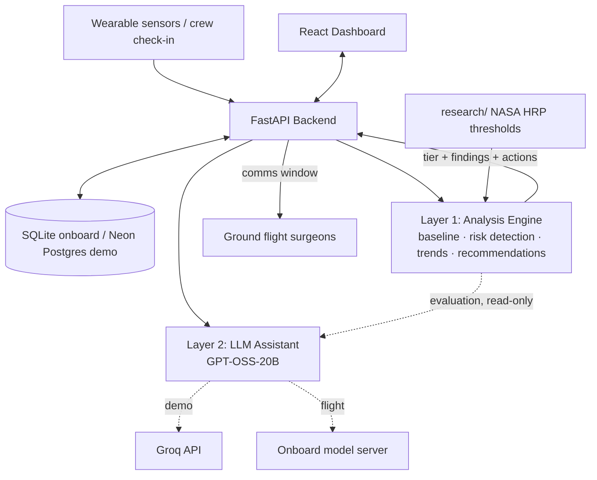

# System Architecture - AstroGuardian-AI

AstroGuardian-AI is engineered with a modular, decoupled architecture to ensure real-time responsiveness, safety compliance, and seamless collaboration across AI, backend, and frontend domains.

## System Workflow Diagram

## Data flow for one reading

1. A reading arrives (`POST /api/astronauts/{id}/readings`) and is stored in the database (SQLite onboard, Postgres when hosted).
2. `ai.health_monitor.evaluate()` loads the astronaut's history, builds a personal baseline from the **previous** readings only, then runs `detect_risk()`:
   absolute limits → multi-day patterns → persistent personal-baseline deviations → 3-day trend projection → missing/stale-data checks.
3. The highest severity among findings becomes the tier (GREEN < UNKNOWN < YELLOW < RED).
4. `get_recommendations()` maps each finding to concrete actions.
5. `backend/service.record_evaluation()` keeps **one open alert per astronaut**: a repeat of the same problem bumps its counter, a new metric or higher tier closes it as *superseded* and opens a new one, and GREEN resolves it. Alerts are exported to ground at the next comms window (`/api/sync/export`).
6. Only on request, the LLM receives the finished evaluation and explains it. It cannot write to the database or alter the tier.

## API

All routes except `/api/health` and `/api/auth/*` need a session (password gate + chosen role). See the permissions table in the README.

| Method | Path | Purpose |
|---|---|---|
| POST | `/api/auth/unlock` | Check the access password |
| POST | `/api/auth/role` | Choose astronaut (with id), cmo or ground |
| GET | `/api/auth/state` | Unlocked? Current role and permissions |
| POST | `/api/auth/switch-role`, `/api/auth/logout` | Back to role picker / lock |
| GET | `/api/crew` | Status card for every astronaut |
| GET | `/api/astronauts/{id}` | Full evaluation (tier, findings, actions, baseline) |
| GET | `/api/astronauts/{id}/readings` | Recent readings, oldest first |
| POST | `/api/astronauts/{id}/readings` | Ingest reading → re-evaluate → log alert |
| POST | `/api/astronauts/{id}/explain` | LLM plain-language explanation |
| POST | `/api/astronauts/{id}/chat` | LLM Q&A grounded in the evaluation |
| GET | `/api/alerts` | Alert log |
| POST | `/api/alerts/{id}/acknowledge` | Acknowledge an alert (CMO) |
| POST | `/api/alerts/{id}/note` | Flight-surgeon advice on an alert (ground) |
| GET | `/api/sync/export` | Ground-sync package |
| POST | `/api/sync/complete` | Mark alerts as synced |
| GET | `/api/config` | LLM mode, stale-data limit, unsynced count |

## Safety design decisions

- **The LLM never decides.** Tiers come from deterministic, unit-tested rules.
- **Fail safe.** Missing heart rate/SpO₂, or data older than `STALE_DATA_HOURS`, yields UNKNOWN rather than GREEN.
- **No self-masking.** The reading under evaluation is excluded from its own baseline.
- **Unreliable baselines are ignored** (fewer than 3 prior readings), so new crew members aren't judged on noise.
- **Trends are fitted on daily averages**, so several readings on the same day can't fake a steep slope.
- **No alert spam.** Moderate personal deviations must persist; repeat readings update one alert.
- **Permissions on the server.** The UI hides what a role can't do, but every route re-checks it.
- **Offline.** A service worker serves the app shell and the last API responses when the server is unreachable. Writes are never queued silently; a reading that can't be saved shows an error.

## Deployment targets

| | Onboard (flight) | Hosted demo |
|---|---|---|
| Server | `uvicorn backend.main:app` on the spacecraft computer | Vercel Python function (`api/index.py`) |
| Database | SQLite file | Neon Postgres (`DATABASE_URL`) |
| LLM | Local GPT-OSS-20B (`LLM_PROVIDER=local`) | Groq API (`LLM_PROVIDER=groq`) |
